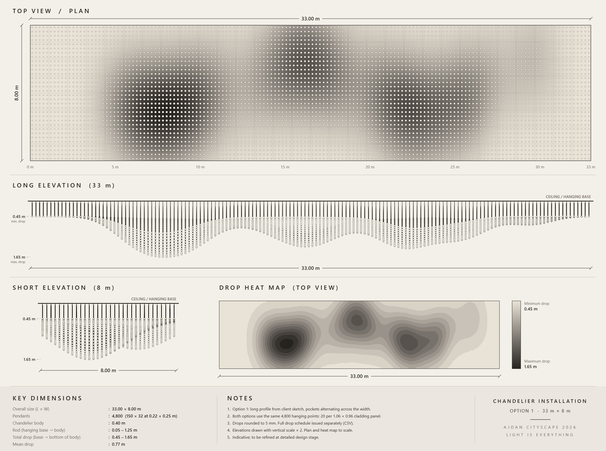
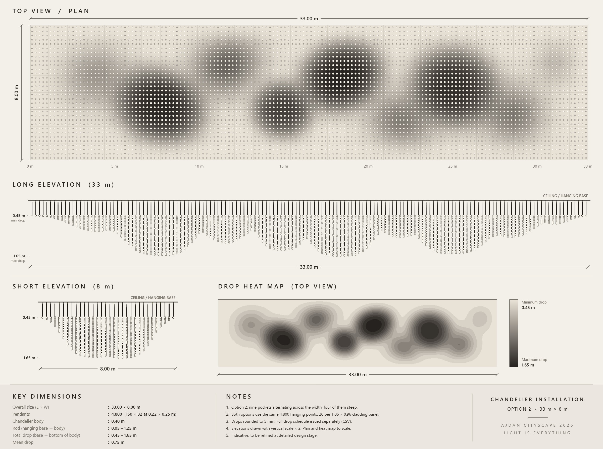

# Ajdan Cityscape 2026 · Chandelier

Suspended light installation: **4,800 pendants** over a **33.00 × 8.00 m** ceiling field, two design options.

| | Option 1 · Smooth Wave | Option 2 · Nine Pockets |
|---|---|---|
| Idea | Long profile traced from the client's sketch; deepest line drifts across the width so pockets read as diagonal ovals | Nine pockets alternating front/back across the width; four steep (P2, P4, P5, P7), five soft |
| Drop range | 0.45 – 1.65 m | 0.45 – 1.65 m |
| Mean drop | 0.78 m | 0.75 m |
| Pendants ≥ 1.40 m | 147 | 383 |
| Max step between neighbours | 0.09 m (smooth everywhere) | ~0.20 m inside the steep pocket walls |




## Fixed design rules

- **Grid:** 150 × 32 points at 0.22 × 0.25 m. These are the same positions as the original drawing, 20 per 1.06 × 0.96 cladding panel.
- **Fitting:** `sketchup/Chandelier one point.skp`, with a 0.40 m black tube and glowing tip (`LIGHT PIECE`) on a rod (`CABLE`).
- **Drop:** measured from the hanging base to the bottom of the fitting. Minimum 0.45 m (0.05 m rod + 0.40 m body), maximum 1.65 m. Values are rounded to 5 mm.
- **Ceiling:** 30 × 60 tape iron in 15 bays of 2.20 m, with 1.06 × 0.96 cladding panels.
- **Hall used in the viewer:** 41.5 × 18 m. The 6.0 m ceiling height is assumed.

## Repository layout

```
sketchup/
  chandelier_build.rb        SketchUp 2022 build script (both options, one tag each)
  lib/claude_su.rb           helper library used by the build script
  Chandelier one point.skp   the fitting (LIGHT PIECE + CABLE components)
viewer/
  src/viewer_template.html   three.js viewer + drawing board (data slot: /*DATA*/)
  src/build_viewer.rb        fills the template from the build script's numbers
  dist/Ajdan_Chandelier_Options_viewer.html   shareable single-file viewer
data/
  Option1_SmoothWave_drop_schedule.csv        drop + rod length for every pendant
  Option2_NinePockets_drop_schedule.csv
  option1_sketch_trace_px.txt                 pixels traced from the client sketch
tools/
  trace_to_profile.rb        sketch trace -> 150-value long profile (Option 1)
  check_smoothness.rb        steepness between neighbouring pendants
  option2_depthmap_data.rb   data for the Option 2 depth map
  depthmap_template.html     Option 2 top-view depth map (contours, pocket labels)
docs/                        client sketch, boards, depth map, renders
```

## Build the SketchUp model

In SketchUp 2022, open a **new empty model**, then go to *Window → Ruby Console* and run:

```ruby
load 'C:/path/to/ajdan-chandelier-2026/sketchup/chandelier_build.rb'
```

This builds the ceiling plus both options, each on its own tag (`OPTION 1 - Smooth Wave`, `OPTION 2 - Nine Pockets`). Show one tag at a time.

- **One option only:** run `ENV['CHANDELIER_OPT'] = '1'` (or `'2'`) first.
- **Changing the fitting:** edit the `LIGHT PIECE` component once and every pendant updates.
- **Drop schedules:** the script writes `Option1_…csv` and `Option2_…csv` next to itself.

## Rebuild the viewer

The viewer is generated from the same numbers SketchUp builds. Use Ruby 2.7 or later:

```
ruby viewer/src/build_viewer.rb
```

This writes `viewer/dist/Ajdan_Chandelier_Options_viewer.html`.

- **Opening it:** it's one file. Open it in Chrome or Edge.
- **Needs internet:** it loads three.js 0.160.0 from jsDelivr.
- **Linking to an option:** add `#option-1` or `#option-2` to the address to open that option.

## Change the design

Everything lives in `sketchup/chandelier_build.rb`:

- **Option 1:**
  - `PROFILE_1`: the traced long profile.
  - `O1_DRAMA`: contrast between pockets and ridges.
  - `O1_SMOOTH`: how gentle the walls are.
  - `O1_WIDTH` and `O1_BELL`: the cross-section across the width.
  - `O1_CENTRE`: where the deepest line sits across the width.
- **Option 2:** `POCKETS_2`, one row per pocket with position, depth, radii, angle and wall steepness.

After a change:
1. Run `ruby tools/check_smoothness.rb 1` (or `2`) and keep the max step under ~0.09 m where walls should look smooth.
2. Rebuild the viewer.
3. Re-run the SketchUp script to refresh the schedules.

## Status

Issued for client review on 22 Oct 2026. Dimensions are indicative and will be refined at detailed design stage.
